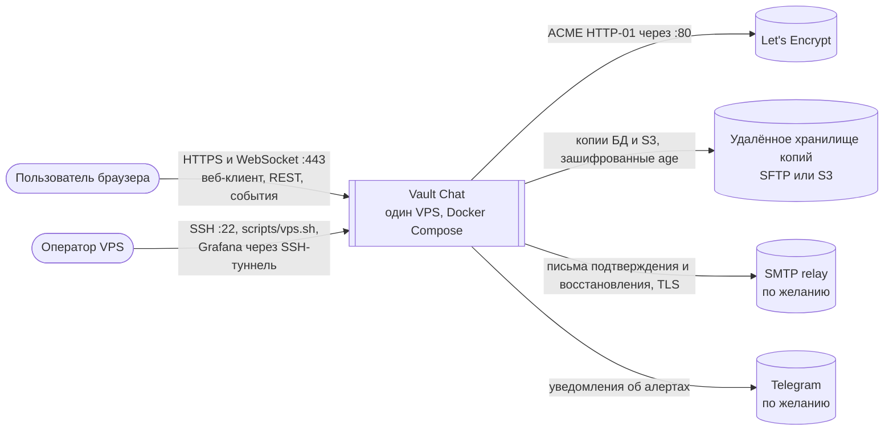
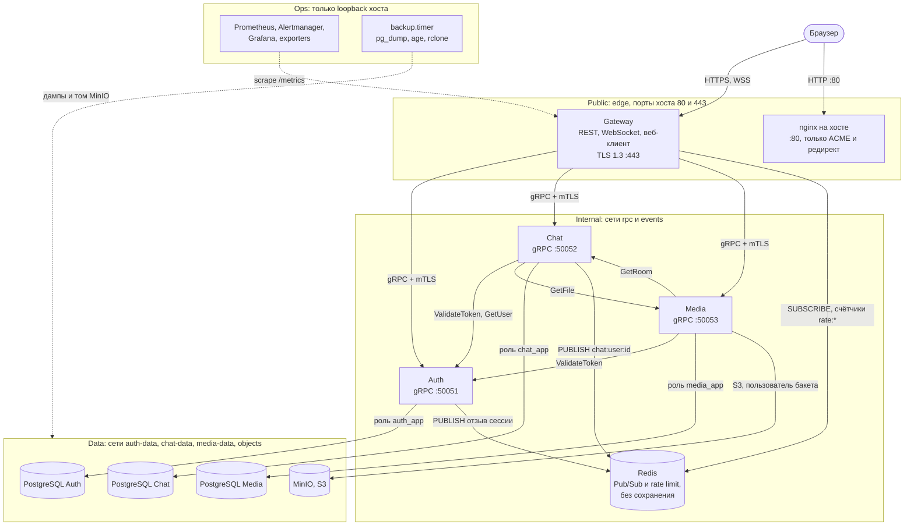

# Контекст и контейнеры Vault Chat (C1/C2)

Диаграммы описывают код `main` и развёртывание на VPS по
[инструкции](deployment.md). Планы из ARCHITECTURE.md сюда не входят; Android-клиент
и push появятся здесь после слияния. Отличия локального Compose — в конце.

## C1: система и внешние участники

Регистрация возможна только по одноразовому приглашению, которое оператор выдаёт
командой `scripts/vps.sh invite EMAIL`.

## C2: контейнеры и связи

Связи gRPC защищены mTLS с private CA развёртывания ([ADR 0001](adr/0001-internal-mtls.md)).
PostgreSQL, Redis и S3 работают без TLS: их защищают отдельные внутренние сети,
пароли и роли с минимальными правами. Одноразовые задачи миграций и `s3-init`
на схеме не показаны: только они получают пароли владельцев БД и ключ root MinIO.

## Зоны доверия

| Зона | Что входит | Кто может подключиться | Защита на границе |
|---|---|---|---|
| Public | Gateway (`edge`, `0.0.0.0:443`), nginx на хосте (`:80`) | Любой в интернете | TLS 1.3, CSP, лимиты по IP и пользователю, лимит входа, ограничения тела и времени запроса, приглашения при регистрации |
| Internal | Auth, Chat, Media (`rpc`), Redis (`events`) | Только контейнеры этих сетей; сети `internal`, без выхода наружу | mTLS с идентичностью сервиса и списком разрешённых RPC, пароль Redis |
| Data | Три PostgreSQL, MinIO (`*-data`, `objects`) | Только сервис-владелец в своей сети | Отдельная сеть на каждую БД, роли `*_app` без DDL, пользователь S3 только своего бакета |
| Ops | Мониторинг, backup, SSH | Оператор через SSH; панели — только через туннель | Ключи SSH, пароль Grafana, шифрование копий age, проверка удалённой копии |

## Где проверяются идентичность и права

| Проверка | Где | Как |
|---|---|---|
| Пользователь | Gateway → Auth `ValidateToken` | Подпись RS256, тип токена, активная семья сессий в БД Auth при каждом запросе |
| Пользователь в WebSocket | Gateway | Первый кадр `auth`; сессия проверяется перед каждым событием и раз в секунду |
| Пользователь в Chat и Media | Chat, Media → Auth `ValidateToken` | Токен пользователя пересылается и проверяется заново |
| Членство в комнате | Chat, в SQL | Проверка в той же транзакции, что чтение или запись |
| Доступ к файлу | Media → Chat `GetRoom` | Членство проверяется при загрузке, после сохранения объекта и при каждом чтении |
| Сервис | Каждый gRPC-сервер | Сертификат клиента от CA развёртывания; URI SAN `spiffe://vault-chat/service/<имя>`; список разрешённых RPC |
| Данные | PostgreSQL, MinIO | Роль сервиса без DDL и суперпользователя; политика S3 только на бакет Media |

Разрешённые вызовы между сервисами: Gateway — любые методы Auth, Chat и Media;
Chat — `Auth.ValidateToken`, `Auth.GetUser`, `Media.GetFile`; Media —
`Auth.ValidateToken`, `Chat.GetRoom`; Auth никого не вызывает. Остальное запрещено.

## Сети VPS

| Сеть | `internal` | Участники |
|---|---|---|
| `edge` | нет | Gateway |
| `rpc` | да | Gateway, Auth, Chat, Media |
| `events` | да | Gateway, Auth, Chat, Redis |
| `objects` | да | Media, MinIO, `s3-init` |
| `auth-data`, `chat-data`, `media-data` | да | Сервис-владелец, его PostgreSQL и задача миграций |

При включённой почте Auth дополнительно получает сеть для исходящего SMTP.

## Отличия локального Compose

Внутренней остаётся только `rpc`; PostgreSQL Auth и Chat, Redis и MinIO
публикуются на `127.0.0.1` для разработки и тестов, Redis без пароля. Gateway отдаёт HTTP на
`127.0.0.1:8080`, mTLS включается отдельным overlay. Контейнер NATS запускается
только с профилем `events` и приложением не используется.
