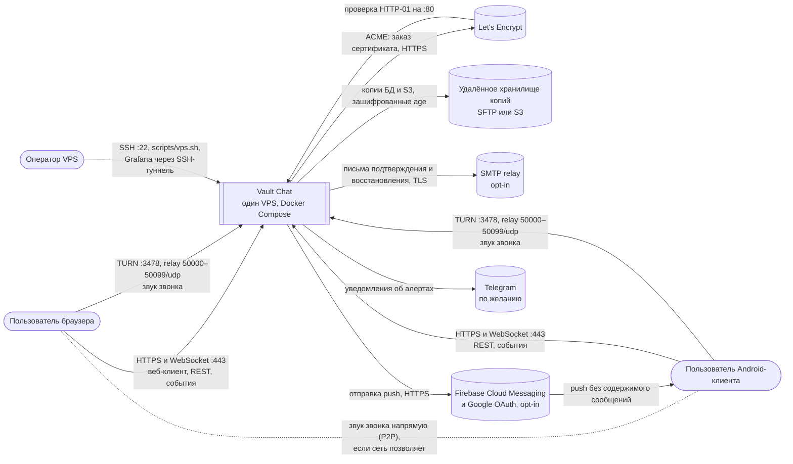
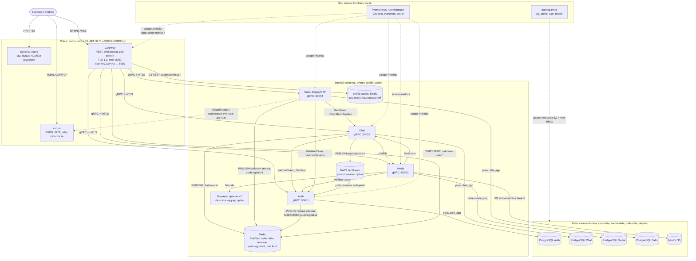

# Контекст и контейнеры Vault Chat (C1/C2)

Диаграммы описывают код `main` и развёртывание на VPS по
[инструкции](deployment.md). Планы из ARCHITECTURE.md сюда не входят.
Компоненты, которые включаются отдельным оверлеем, помечены «opt-in».
Отличия локального Compose — в конце.

## C1: система и внешние участники

Регистрация возможна только по одноразовому приглашению, которое оператор выдаёт
командой `scripts/vps.sh invite EMAIL`. Звонки — только личные аудиозвонки; P2P
возможен между любыми двумя клиентами, а не только браузером и Android.

## C2: контейнеры и связи

Связи gRPC защищены mTLS с private CA развёртывания ([ADR 0001](adr/0001-internal-mtls.md));
сервер Calls на Erlang сам проверяет, что клиент — Gateway. PostgreSQL, Redis и
S3 работают без TLS: их защищают отдельные внутренние сети, пароли и роли с
минимальными правами. NATS требует mTLS. Мониторинг собирает метрики пяти
сервисов через отдельные internal-сети `metrics-*` с фиксированными адресами
([ADR 0007](adr/0007-monitoring-access.md)). Одноразовые задачи миграций и
`s3-init` на схеме не показаны. Пароли владельцев БД получают только задачи
миграций; ключ root MinIO — сам MinIO и `s3-init`, но не Media. Auth отправляет
push в FCM и письма в SMTP через отдельные egress-сети, если эти оверлеи
включены.

## Зоны доверия

| Зона | Что входит | Кто может подключиться | Защита на границе |
|---|---|---|---|
| Public | Gateway (`edge`, `0.0.0.0:443`), nginx на хосте (`:80`), coturn (сеть хоста, `3478`, relay `50000–50099/udp`) | Любой в интернете | Gateway: TLS 1.3, CSP, лимиты по IP и пользователю, лимит входа, ограничения тела и времени запроса, приглашения при регистрации. coturn: временные учётные данные, подписанные общим с Calls секретом, срок allocation не больше 10 минут, relay к частным адресам запрещён |
| Internal | Auth, Chat, Media, Calls (`rpc`), Redis (`events`), кэш профилей (`profile-cache`, только Gateway); opt-in: NATS (`push-signals`), воркеры превью (`preview`) | Только контейнеры этих сетей. `internal` запрещает выход наружу через эту сеть, а не весь egress контейнера: контейнер в другой, обычной сети выходит через неё (Gateway — через `edge`, Auth с почтой и push — через `mail-egress` и `push-egress`) | mTLS с идентичностью сервиса и списком разрешённых RPC, пароль Redis, отдельный пароль кэша профилей, mTLS и права на subject в NATS |
| Data | Четыре PostgreSQL, MinIO (`*-data`, `objects`) | Только сервис-владелец в своей сети | Отдельная сеть на каждую БД, роли `*_app` без DDL, пользователь S3 только своего бакета |
| Ops | Мониторинг, backup, SSH | Оператор через SSH; панели — только через туннель | Ключи SSH, пароль Grafana, шифрование копий age, проверка удалённой копии |

## Где проверяются идентичность и права

| Проверка | Где | Как |
|---|---|---|
| Пользователь | Gateway → Auth `ValidateToken` | Подпись RS256, тип токена, активная семья сессий в БД Auth при каждом запросе |
| Пользователь в WebSocket | Gateway | Первый кадр `auth`; сессия проверяется перед каждым событием и раз в секунду |
| Пользователь в Chat, Media и Calls | Chat, Media, Calls → Auth `ValidateToken` | Токен пользователя пересылается и проверяется заново |
| Членство в комнате | Chat, в SQL | Проверка в той же транзакции, что чтение или запись |
| Доступ к файлу | Media → Chat `GetRoom` | Членство проверяется при загрузке, после сохранения объекта и при каждом чтении |
| Участники звонка | Calls → Chat `GetRoom`, затем периодически `Auth.ValidateSession` и `Chat.CheckMembership` | Звонок только в личной комнате вызывающего; идущий звонок завершается после отзыва сессии или удаления участника |
| Сервис | Каждый gRPC-сервер | Сертификат клиента от CA развёртывания; URI SAN `spiffe://vault-chat/service/<имя>`; список разрешённых RPC. Calls принимает только Gateway |
| Данные | PostgreSQL, MinIO | Роль сервиса без DDL и суперпользователя; политика S3 только на бакет Media |

Разрешённые вызовы между сервисами ([матрица](mtls.md)): Gateway — любые методы
Auth, Chat, Media и Calls; Chat — `Auth.ValidateToken`, `Auth.GetUser`,
`Media.GetFile`; Media — `Auth.ValidateToken`, `Chat.GetRoom`, `Preview.Decode`;
Calls — `Auth.ValidateToken`, `Auth.ValidateSession`, `Chat.GetRoom`,
`Chat.CheckMembership`; Auth и воркеры превью никого не вызывают. Любому
сервису разрешены health `Check` и `Watch`. Остальное запрещено.

## Сети VPS

| Сеть | `internal` | Участники |
|---|---|---|
| `edge` | нет | Gateway |
| `rpc` | да | Gateway, Auth, Chat, Media, Calls |
| `events` | да | Gateway, Auth, Chat, Calls, Redis |
| `profile-cache` | да | Gateway и Redis кэша профилей |
| `objects` | да | Media, MinIO, `s3-init` |
| `auth-data`, `chat-data`, `media-data`, `calls-data` | да | Сервис-владелец, его PostgreSQL и задача миграций |
| `metrics-*` | да | Один сервис или экспортер и Prometheus мониторинга (opt-in) |
| `push-signals` | да | Auth, Chat, NATS (opt-in push) |
| `push-egress` | нет | Auth для FCM (opt-in push) |
| `mail-egress` | нет | Auth для SMTP (opt-in почта) |
| `preview` | да | Media и воркеры превью (opt-in) |

coturn работает в сети хоста и в эти сети не входит.

## Отличия локального Compose

Внутренними остаются `rpc` и `profile-cache`; PostgreSQL Auth, Chat и Calls,
Redis и MinIO публикуются на `127.0.0.1` для разработки и тестов, Redis без
пароля. Gateway отдаёт HTTP на `127.0.0.1:8080`, mTLS включается отдельным
overlay. NATS в базовый Compose не входит и запускается push-оверлеем.
